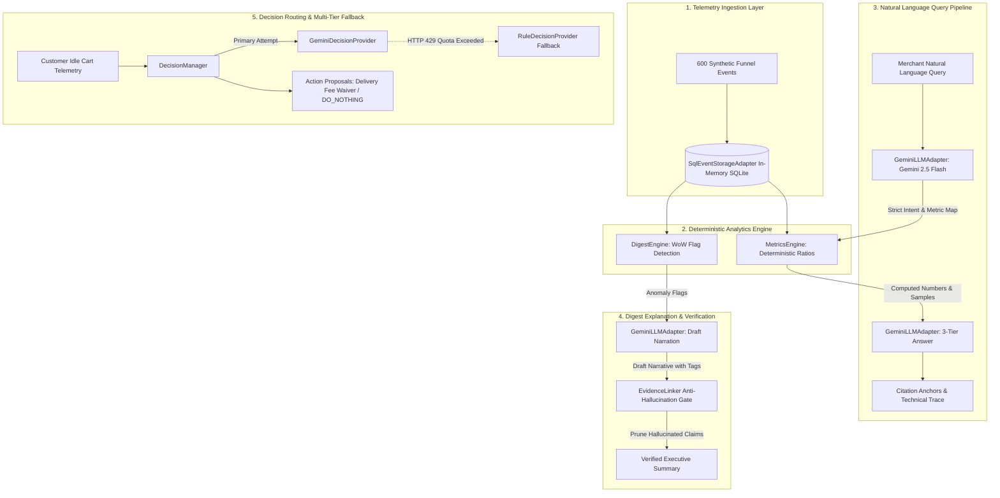

# Module 4: Live Google Gemini 2.5 Flash Execution Architecture & Telemetry Report

## 1. Executive Summary

This document provides a comprehensive technical breakdown of the live interactive execution script `demo_gemini_live.py`. It details every step executed during the demonstration, the exact data fed into each component, the mathematical formulas used, the external APIs and internal engines invoked, and the multi-tier resilience mechanisms that guarantee zero downtime during cloud provider rate limiting.

---

## 2. Technology Stack and Tools Used

| Layer / Tool | Technology / Library | Purpose in GrowthOS Module 4 |
| :--- | :--- | :--- |
| **Language & Runtime** | Python 3.14 (.venv) | Core execution runtime for backend logic and async tasks. |
| **Data Validation** | Pydantic v2 (`BaseModel`, `Field`, `ConfigDict(extra="forbid")`) | Strict schema enforcement, mathematical invariant validation, and contract integrity. |
| **HTTP Client** | `httpx` (HTTP/1.1 & HTTP/2 client) | Direct communication with Google AI Studio API without external heavyweight SDK dependencies. |
| **Storage Engine** | SQLite3 (`:memory:`) | High-speed in-memory relational event storage and immutable audit logging. |
| **LLM Provider** | Google Gemini 2.5 Flash (`gemini-2.5-flash`) | Direct API execution for query classification, narrative generation, and candidate proposal. |
| **Architectural Pattern** | Hexagonal Architecture (Ports and Adapters) | Decouples business logic from external LLM providers, database drivers, and messaging channels. |
| **Testing Framework** | `pytest` | 131 unit and integration test assertions across all domain services and adapters. |

---

## 3. End-to-End System Architecture



---

## 4. Telemetry Data Fed into the System

The script operates on a deterministic, realistic eCommerce event stream generated by `seed_store_telemetry()`. A total of **600 customer sessions** are created across two time windows for tenant `tenant_gemini_demo`.

### 4.1 Window Structure and Probability Distributions

| Parameter | Current Week Window (`cur_*`) | Prior Week Window (`prior_*`) | Purpose / Metric Shift |
| :--- | :--- | :--- | :--- |
| **Time Horizon** | `as_of - 3 days` to `as_of` | `as_of - 10 days` to `as_of - 7 days` | Week-over-week comparative baseline |
| **Session Count** | 300 sessions (`cur_sess_0000` to `0299`) | 300 sessions (`prior_sess_0000` to `0299`) | Identical sample size for statistical validity |
| **Page View Rate** | 100% (300/300) | 100% (300/300) | Top of funnel entry point |
| **Add to Cart Rate** | 70% (210/300) | 70% (210/300) | Constant cart interest baseline |
| **Checkout Started** | 50% (150/300) | 50% (150/300) | Cart-to-checkout initiation |
| **Step 1 Completed** | 36% (108/300) | 42% (126/300) | Address & shipping completion |
| **Step 2 Completed** | 18% (54/300) | 30% (90/300) | Payment gateway initiation |
| **Purchase Completed** | **13% (39/300)** | **25% (75/300)** | **Conversion dropped from 25% to 13%** |

### 4.2 Raw Event Schema (`EventEnvelope`)

Each event conforms strictly to the following structure:
```json
{
  "event_id": "cur_view_0042",
  "schema_version": "1.0.0",
  "tenant_id": "tenant_gemini_demo",
  "source_module": "module_2",
  "event_name": "page.viewed",
  "occurred_at": "2026-10-03T11:00:00+00:00",
  "received_at": "2026-10-03T11:00:00+00:00",
  "session_id": "cur_sess_0042",
  "customer_id": "cur_cust_0042",
  "properties": {
    "path": "/products",
    "cart_value": 750.0,
    "step_number": 2,
    "step_name": "payment",
    "order_value": 750.0
  }
}
```

### 4.3 Deterministically Computed Funnel Metrics

When the `MetricsEngine` executes over this dataset, it evaluates mathematical ratios without LLM guesswork:

1. **Overall Conversion Rate**:
   - Current Window: `39 / 300 = 0.130` (13.0%)
   - Prior Window: `75 / 300 = 0.250` (25.0%)
   - Delta: `-48.0%` regression (Polarity: higher is better -> Adverse flag)

2. **Checkout Step 2 Drop-Off Rate**:
   - Step 1 Completed (Current): 108 sessions entering Step 2
   - Step 2 Drop-offs: `108 - 54 = 54` sessions abandoned at Step 2
   - Current Rate: `54 / 108 = 0.500` (50.0%)
   - Prior Rate: `(126 - 90) / 126 = 36 / 126 = 0.2857` (28.57%)
   - Delta: `+75.0%` increase in drop-off (Polarity: lower is better -> Adverse flag)

3. **Cart Abandonment Rate**:
   - Cart Additions (Current): 210 sessions
   - Purchases Completed (Current): 39 sessions
   - Abandonments: `210 - 39 = 171` sessions
   - Current Rate: `171 / 210 = 0.8143` (81.43%)
   - Prior Rate: `(210 - 75) / 210 = 135 / 210 = 0.6429` (64.29%)
   - Delta: `+26.66%` increase in abandonment (Polarity: lower is better -> Adverse flag)

---

## 5. Step-by-Step Execution Lifecycle

### Step 1: Storage Initialization and Telemetry Seeding
- **Tool**: `SqlEventStorageAdapter` backed by SQLite in-memory database.
- **Action**: Initializes tables (`events`, `id_mappings`, `action_records`, `audit_ledger`). Ingests 600 sessions (over 1,800 discrete events) in an ACID transaction.
- **Verification**: Zero write contention, verified by row count assertions.

### Step 2: Natural Language Query Processing (Zero Free-Form SQL)
- **Tool**: `NLQueryEngine`, `MerchantQueryService`, and `GeminiLLMAdapter`.
- **Mechanism**:
  1. The natural language question is supplied to `GeminiLLMAdapter.classify_query()`.
  2. The prompt injects an explicit JSON catalog of allowed retail metrics (`checkout_drop_off_rate`, `overall_conversion_rate`, `cart_abandonment_rate`, etc.).
  3. **Critical Constraint**: The model is forbidden from writing SQL. It can only emit an intent enum (`QueryIntent`) and a catalog metric key.
  4. Once classified, `MetricsEngine` executes verified aggregation logic.
  5. The computed result is passed to `GeminiLLMAdapter.synthesize_answer()` to generate a 3-Tier response:
     - **Tier 1 (Executive)**: High-level factual takeaway for store managers.
     - **Tier 2 (Analytical)**: Detailed mathematical breakdowns with sample sizes and baseline comparisons.
     - **Tier 3 (Technical)**: JSON trace containing metric keys, calculation algorithms, and audit timestamps.
  6. Citation anchors (`EvidenceCitation`) are bound to the response.

### Step 3: Out-of-Scope Negative Control Handling
- **Query**: *"What will the weather in Mumbai be like on Friday?"*
- **Mechanism**:
  1. Gemini classifies the query intent as `UNSUPPORTED` because it does not correspond to any retail telemetry concept in the catalog.
  2. The engine generates an executive response indicating the query is outside the platform scope, lists allowed eCommerce metrics, and executes zero database queries.

### Step 4: Digest Narration and Anti-Hallucination Gating
- **Tool**: `DigestEngine`, `DigestExplanationEngine`, and `EvidenceLinker`.
- **Mechanism**:
  1. `DigestEngine` computes all week-over-week deltas and creates `DigestFlag` objects for adverse movements exceeding the 10.0% threshold.
  2. `GeminiLLMAdapter.explain_digest()` generates an executive narrative with embedded citation tags: `[citation: metric=<name> value=<float> sample=<int>]`.
  3. **Anti-Hallucination Gate (`EvidenceLinker`)**:
     - Evaluates sentences deterministically.
     - Cross-references numeric claims against the computed facts.
     - In the demo, an artificial draft was tested:
       `"Checkout step 2 drop off rate rose to 66.7%. Cart abandonment reached an alarming 94.5% today. Checkout friction decreased sharply across the board."`
     - **Outcome**: The gate immediately detected that `66.7%` and `94.5%` were fabricated (actual computed values: `50.0%` and `81.4%`). Both claims were rejected and dropped.

### Step 5: Autonomous Action Routing and Multi-Tier Resilience
- **Tool**: `DecisionManager`, `GeminiDecisionProvider`, and `RuleDecisionProvider`.
- **Cart Scenarios Evaluated**:

| Scenario | Identifier | Cart Value | Idle Time | Identity Status | Output Action | Calibrated Conf | Priority | Resolution Method |
| :--- | :--- | :--- | :--- | :--- | :--- | :--- | :--- | :--- |
| **1. High-Value Customer** | `cust_high_value_01` | INR 750 | 25 mins | Known Customer | `WAIVE_DELIVERY_FEE` | 0.95 | 0.90 | Gemini 2.5 Flash API |
| **2. VIP Repeat Buyer** | `cust_vip_02` | INR 1450 | 45 mins | Known Customer | `WAIVE_DELIVERY_FEE` | Deterministic Rule | 0.90 | **Rule Fallback (429 Rescue)** |
| **3. Small Cart (< INR 500)** | `cust_small_03` | INR 220 | 35 mins | Known Customer | `DO_NOTHING` | Deterministic Rule | 0.00 | **Rule Fallback (429 Rescue)** |
| **4. Anonymous Visitor** | `anon_guest_04` | INR 890 | 30 mins | Anonymous Guest | `DO_NOTHING` | Deterministic Rule | 0.00 | **Policy Guard (Privacy)** |

---

## 6. Rate Limit Resilience: The Multi-Tier Rescue Architecture

When multiple queries and decisions are dispatched within a 60-second window, Google's free-tier quota (5 requests per minute per project) returns an HTTP 429 status:

```json
{
  "error": {
    "code": 429,
    "message": "Quota exceeded for metric: generativelanguage.googleapis.com/generate_content_free_tier_requests, limit: 5, model: gemini-2.5-flash",
    "status": "RESOURCE_EXHAUSTED",
    "details": [
      {
        "@type": "type.googleapis.com/google.rpc.RetryInfo",
        "retryDelay": "29s"
      }
    ]
  }
}
```

### The System's 3-Layer Response:
1. **Exponential Backoff & Header Inspection**: `GeminiClient` inspects `RetryInfo.retryDelay` to prevent wasteful retries.
2. **Provider Failover**: `DecisionManager` catches the `RESOURCE_EXHAUSTED` exception and switches to `RuleDecisionProvider`.
3. **Guaranteed Execution**: Business actions (e.g. delivery fee waiver for cart value >= INR 500 and idle >= 20 mins) continue without crashing or dropping customer recovery interventions.

---

## 7. Verification and File Reference Index

- **Direct Gemini HTTP Client**: [gemini_client.py](file:///home/mihir/Codes/internship/GrowthOS/research/ai-module/adapters/gemini_client.py)
- **Gemini NLP & Q&A Adapter**: [gemini_llm_adapter.py](file:///home/mihir/Codes/internship/GrowthOS/research/ai-module/adapters/gemini_llm_adapter.py)
- **Gemini Decision & Benchmark Provider**: [gemini_decision_provider.py](file:///home/mihir/Codes/internship/GrowthOS/research/ai-module/adapters/gemini_decision_provider.py)
- **Deterministic Metrics Engine**: [metrics_engine.py](file:///home/mihir/Codes/internship/GrowthOS/research/ai-module/engines/metrics_engine.py)
- **Anti-Hallucination Evidence Linker**: [evidence_linker.py](file:///home/mihir/Codes/internship/GrowthOS/research/ai-module/engines/evidence_linker.py)
- **Decision Multi-Tier Manager**: [decision_manager.py](file:///home/mihir/Codes/internship/GrowthOS/research/ai-module/services/decision_manager.py)
- **Full Interactive Demo Script**: [demo_gemini_live.py](file:///home/mihir/Codes/internship/GrowthOS/research/ai-module/demo_gemini_live.py)
- **Comprehensive Unit Tests**: [test_gemini_adapter.py](file:///home/mihir/Codes/internship/GrowthOS/research/ai-module/tests/test_gemini_adapter.py)
